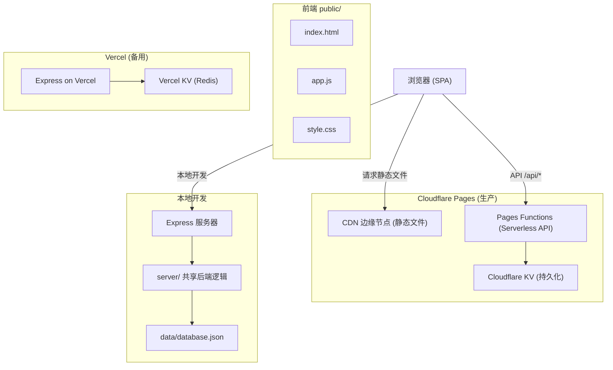
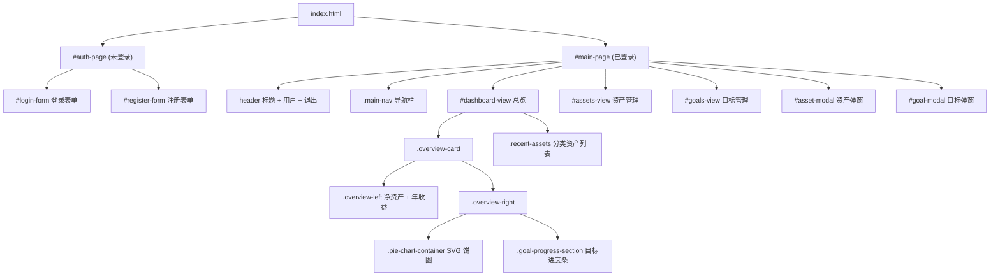
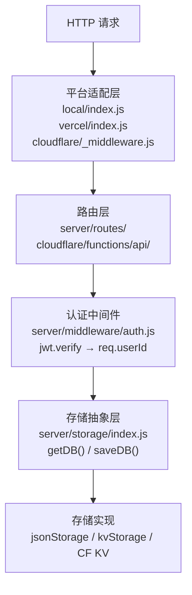
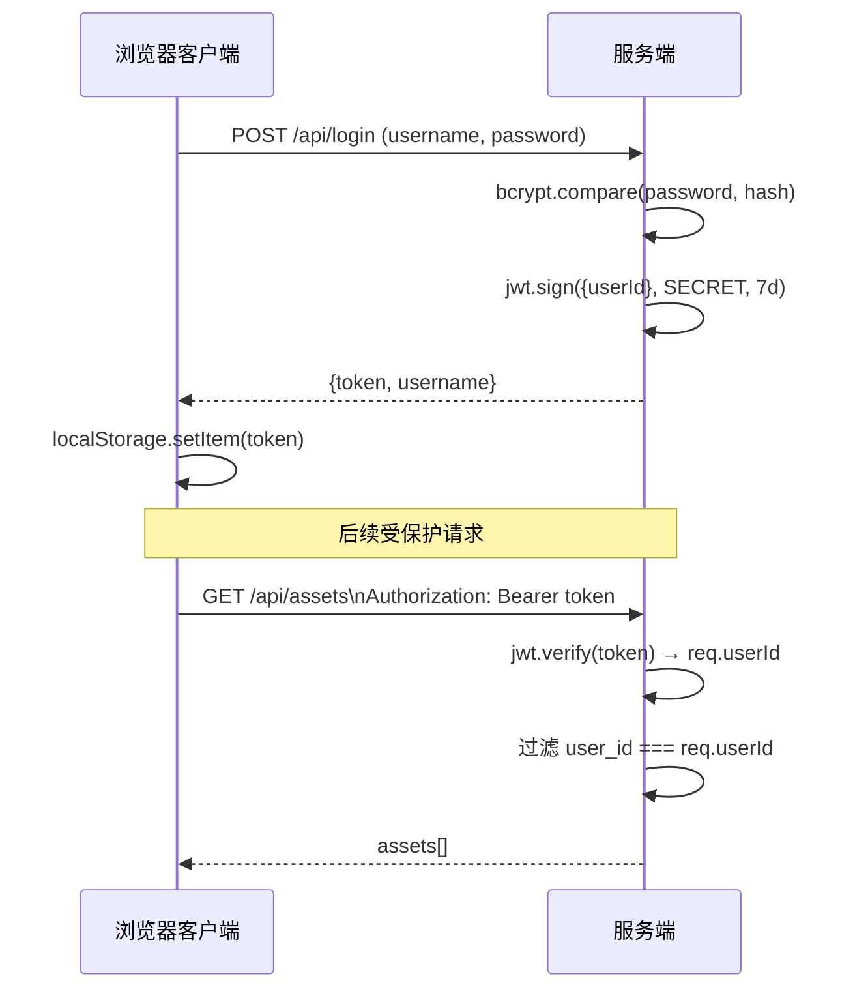
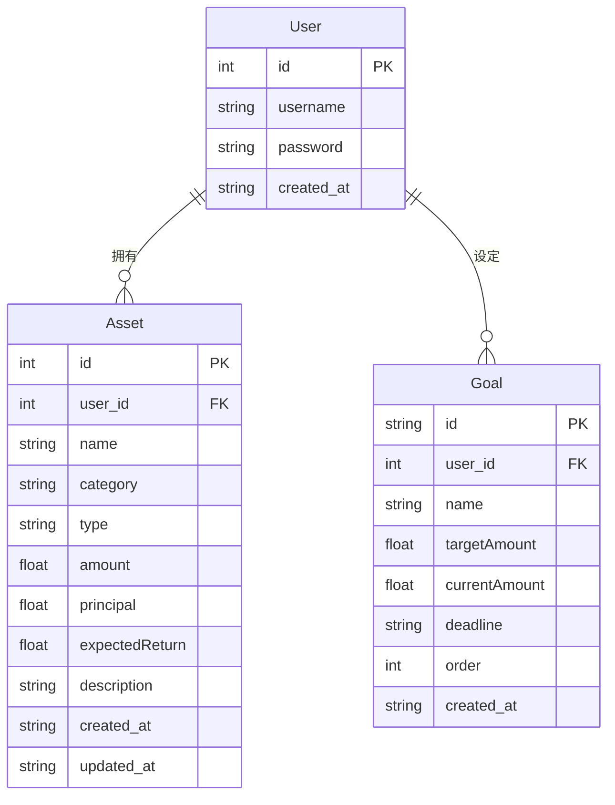
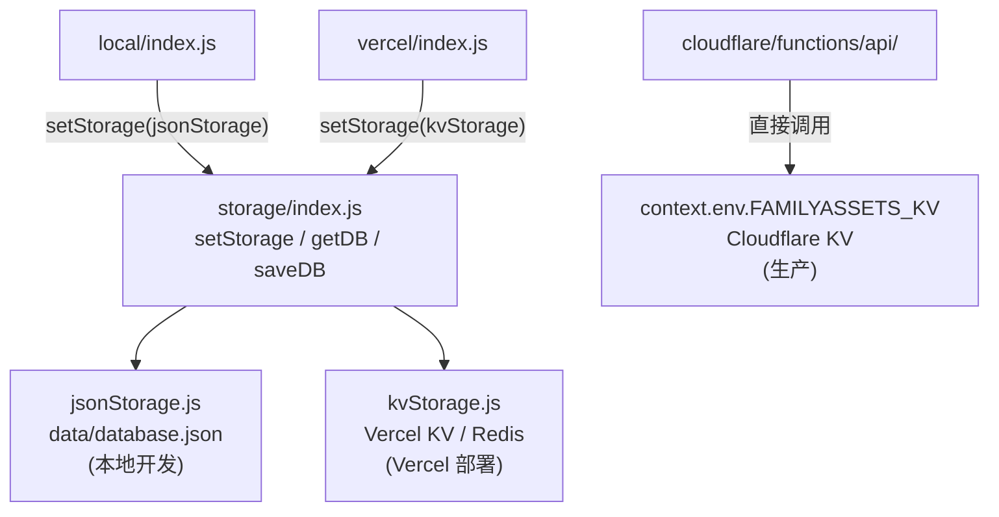
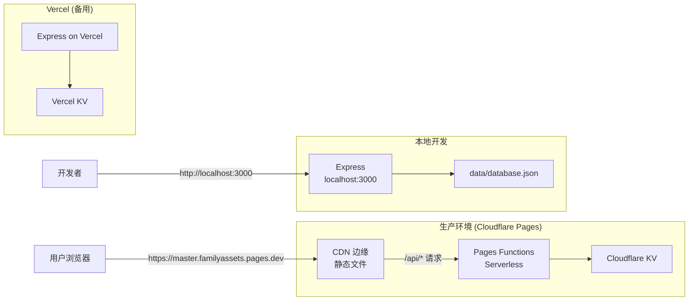
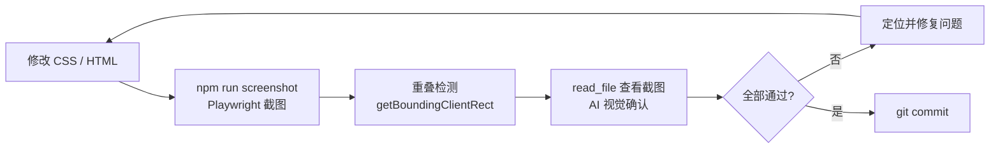

# 家庭资产管理系统 — 架构文档

> 更新日期：2026-05-08

---

## 目录

1. [项目概述](#1-项目概述)
2. [技术栈](#2-技术栈)
3. [目录结构](#3-目录结构)
4. [前端架构](#4-前端架构)
5. [后端架构](#5-后端架构)
6. [API 接口清单](#6-api-接口清单)
7. [数据模型](#7-数据模型)
8. [存储层](#8-存储层)
9. [部署架构](#9-部署架构)
10. [开发工具](#10-开发工具)

---

## 1. 项目概述

家庭资产管理系统是一个多人账户的个人财务追踪工具，支持资产录入、分类统计、理财目标管理等功能。

核心特性：
- 多用户 JWT 鉴权，数据完全隔离
- 资产按「现金 / 固收 / 权益 / 另类 / 负债」五大类管理
- 首页 SVG 饼图可视化资产配置
- 理财目标进度追踪（支持拖拽排序）
- 三端同构后端逻辑：本地 / Vercel / Cloudflare Pages 均可部署

### 系统整体架构



---

## 2. 技术栈

### 前端

**编程语言**
| 语言 | 规范 | 说明 |
|------|------|------|
| JavaScript | ES2020+，浏览器原生脚本 | 无框架，无构建步骤，无 TypeScript |
| HTML | HTML5 | 单页面标记，`index.html` 承载完整 SPA 结构 |
| CSS | CSS3 + 自定义属性 | 暗色设计系统，无预处理器（Sass/Less） |

**基础协议与规范**
| 协议/规范 | 说明 |
|----------|------|
| Fetch API | 原生 HTTP 请求，封装为 `authFetch` 统一携带 JWT |
| Web Storage API | `localStorage` 持久化 token 与用户名 |
| SVG 1.1 | 手绘饼图，原生 `<path>` 路径计算，不依赖图表库 |
| HTML5 Drag and Drop API | 桌面端目标拖拽排序 |
| Touch Events | 移动端目标拖拽排序 |

---

### 后端

**编程语言**
| 语言 | 规范 | 说明 |
|------|------|------|
| JavaScript | Node.js CommonJS（`require`） | 前后端同一语言，无 TypeScript |

**基础协议与规范**
| 协议/规范 | 说明 |
|----------|------|
| HTTP/HTTPS + REST | API 设计风格，`/api/*` 路径规范 |
| JWT（RFC 7519） | 无状态鉴权令牌，`Authorization: Bearer` 头传递，有效期 7 天 |
| bcrypt | 密码哈希算法，salt rounds = 10 |

**运行时与平台**
| 运行时 | 说明 |
|--------|------|
| Node.js v20+ | 本地开发与 Vercel 部署的服务端运行时 |
| Cloudflare Pages Functions | 生产 Serverless 边缘运行时，ES Module 格式 |
| Vercel Serverless | 备用部署平台，复用同一 Express 应用 |

**核心依赖库**
| 库 | 版本 | 用途 |
|----|------|------|
| express | ^4.18 | HTTP 路由框架（本地/Vercel） |
| jsonwebtoken | ^9.0 | JWT 签发与校验 |
| bcryptjs | ^2.4 | bcrypt 算法的纯 JS 实现 |
| @vercel/kv | ^2.0 | Vercel Redis 兼容 KV 客户端 |
| Cloudflare KV | — | 生产持久化存储，binding: `FAMILYASSETS_KV` |

---

### 开发工具
| 工具 | 版本 | 用途 |
|------|------|------|
| Playwright | ^1.44 | 多视口截图 + 布局重叠自动检测 |
| Wrangler | ^4.75 | Cloudflare Pages 部署 CLI |

---

## 3. 目录结构

```
familyassets/
├── public/                    # 前端静态资源（部署到 CDN）
│   ├── index.html             # 单页应用 HTML（181 行）
│   ├── app.js                 # 全部前端逻辑（696 行）
│   └── style.css              # 设计系统 + 响应式样式（~980 行）
│
├── server/                    # 共享后端逻辑（平台无关）
│   ├── app.js                 # Express App 工厂函数
│   ├── middleware/
│   │   └── auth.js            # JWT 校验中间件
│   ├── routes/
│   │   ├── auth.js            # 注册 / 登录路由
│   │   └── assets.js          # 资产 CRUD + 统计路由
│   └── storage/
│       ├── index.js           # 存储抽象层（setStorage / getDB / saveDB）
│       ├── jsonStorage.js     # 本地 JSON 文件存储
│       └── kvStorage.js       # Vercel KV 存储适配
│
├── cloudflare/                # Cloudflare Pages 部署包
│   ├── wrangler.toml          # 项目名: familyassets，KV 绑定配置
│   └── functions/api/         # Serverless Function handlers
│       ├── _middleware.js     # CORS + 路由前置处理
│       ├── _utils.js          # JWT / 加密工具（独立于 server/）
│       ├── login.js           # POST /api/login
│       ├── register.js        # POST /api/register
│       ├── statistics.js      # GET /api/statistics
│       ├── assets/
│       │   ├── index.js       # GET/POST /api/assets
│       │   └── [id].js        # PUT/DELETE /api/assets/:id
│       └── goals/
│           ├── index.js       # GET/POST /api/goals
│           ├── [id].js        # PUT/DELETE /api/goals/:id
│           └── reorder.js     # POST /api/goals/reorder
│
├── local/index.js             # 本地开发入口（Express + JSON 文件存储）
├── vercel/index.js            # Vercel 部署入口（Express + KV 存储）
├── scripts/screenshot.js      # Playwright 截图与重叠检测脚本
├── .comate/rules/             # AI 编程规范（Comate 自动加载）
├── data/database.json         # 本地数据文件（gitignore）
└── package.json
```

---

## 4. 前端架构

### 4.1 页面结构

单页应用，通过 `.hidden` 类切换视图：



### 4.2 状态管理

无框架状态管理，使用模块级变量：

```javascript
let token       = localStorage.getItem('token');      // JWT
let currentUser = localStorage.getItem('username');   // 用户名
let allAssets   = [];   // 资产缓存（loadDashboard 后填充）
let allGoals    = [];   // 目标缓存（loadDashboard 后填充）
```

### 4.3 关键函数

| 函数 | 作用 | 位置 |
|------|------|------|
| `authFetch(url, options)` | 统一附加 Authorization 头 | app.js:47 |
| `showMainPage()` | 切换到主页 + 触发 loadDashboard | app.js:240 |
| `loadDashboard()` | 并发拉取资产+目标，渲染总览 | app.js:248 |
| `renderCategoryPieChart(assets)` | SVG 路径计算，绘制饼图 | app.js:373 |
| `renderGoalProgress(goals, netWorth)` | 计算目标完成度，渲染进度条 | app.js:341 |
| `loadAssets()` | 渲染资产管理列表 | app.js:434 |
| `loadGoals()` | 渲染目标列表 | app.js:530 |
| `initGoalDnD(list)` | 桌面 HTML5 拖拽 + 移动端 Touch 拖拽 | app.js:563 |

### 4.4 响应式断点

| 断点 | 主要变化 |
|------|---------|
| `≤ 768px` | `.overview-card` 改为垂直排列；资产列表换行显示 |
| `≤ 480px` | 按钮缩小间距 |
| `≤ 400px` | `.overview-right` 强制列布局，防止饼图与目标进度重叠 |

### 4.5 资产分类颜色

| 分类 | 颜色 | 用途 |
|------|------|------|
| 现金 | `#22c55e` | 绿色 |
| 固收 | `#3b82f6` | 蓝色 |
| 权益 | `#f59e0b` | 琥珀色 |
| 另类 | `#a855f7` | 紫色 |
| 负债 | `#ef4444` | 红色 |

---

## 5. 后端架构

### 5.1 分层设计



### 5.2 认证流程



### 5.3 Cloudflare Functions 说明

Cloudflare 版本不使用 Express，每个文件导出 `onRequest(context)` 函数，依赖 `_utils.js` 实现 JWT 校验，直接读写 `context.env.FAMILYASSETS_KV`。

---

## 6. API 接口清单

所有接口均以 `/api` 为前缀，需要鉴权的接口须携带 `Authorization: Bearer <token>` 请求头。

### 认证接口

| 方法 | 路径 | 鉴权 | 说明 |
|------|------|------|------|
| POST | `/api/register` | 无 | 用户注册（密码 ≥ 6 位） |
| POST | `/api/login` | 无 | 用户登录，返回 JWT token |

### 资产接口

| 方法 | 路径 | 鉴权 | 说明 |
|------|------|------|------|
| GET | `/api/assets` | 需要 | 获取当前用户全部资产（按创建时间倒序） |
| POST | `/api/assets` | 需要 | 新增资产 |
| PUT | `/api/assets/:id` | 需要 | 更新资产 |
| DELETE | `/api/assets/:id` | 需要 | 删除资产 |
| GET | `/api/assets/statistics` | 需要 | 按类型汇总统计 |

### 目标接口（仅 Cloudflare 版本）

| 方法 | 路径 | 鉴权 | 说明 |
|------|------|------|------|
| GET | `/api/goals` | 需要 | 获取目标列表（按 order 排序） |
| POST | `/api/goals` | 需要 | 新增目标 |
| PUT | `/api/goals/:id` | 需要 | 更新目标 |
| DELETE | `/api/goals/:id` | 需要 | 删除目标 |
| POST | `/api/goals/reorder` | 需要 | 拖拽排序（提交新 order 数组） |

### 统计接口

| 方法 | 路径 | 鉴权 | 说明 |
|------|------|------|------|
| GET | `/api/statistics` | 需要 | 总资产、资产数量、分类统计 |

---

## 7. 数据模型

### ER 图



### Asset 字段说明

- `category`：五大分类之一（现金 / 固收 / 权益 / 另类 / 负债）
- `type`：细分类型（如「货币基金」「股票」「活期存款」）
- `amount`：当前市值，负债填负数
- `principal`：成本/本金（用于计算收益率）
- `expectedReturn`：预期年化收益率（%）

### 本地数据库结构（data/database.json）

```json
{
  "users": [],
  "assets": [],
  "goals": [],
  "nextUserId": 1,
  "nextAssetId": 1
}
```

---

## 8. 存储层

存储层通过依赖注入解耦，不同平台在启动时注入对应实现：



---

## 9. 部署架构

### 三端部署对比



### 生产部署命令

```bash
export PATH=$HOME/.n/bin:$PATH
cd cloudflare && npx wrangler pages deploy ../public \
  --project-name familyassets \
  --commit-dirty=true \
  --commit-message="deploy latest"
```

访问地址：https://master.familyassets.pages.dev

### 本地开发

```bash
npm start   # node local/index.js → http://localhost:3000
```

---

## 10. 开发工具

### 布局验证脚本（scripts/screenshot.js）

每次修改 `public/style.css` 或 `public/index.html` 后必须运行：

```bash
npm run screenshot
```

#### 验证工作流



#### 覆盖视口

| 截图文件 | 尺寸 | 模拟设备 |
|---------|------|---------|
| `mobile-375.png` | 375×812 | iPhone SE |
| `mobile-390.png` | 390×844 | iPhone 14 |
| `tablet-768.png` | 768×1024 | iPad |
| `desktop-1280.png` | 1280×800 | 桌面 |

退出码：`0` = 全部通过，`1` = 检测到重叠或脚本异常。
